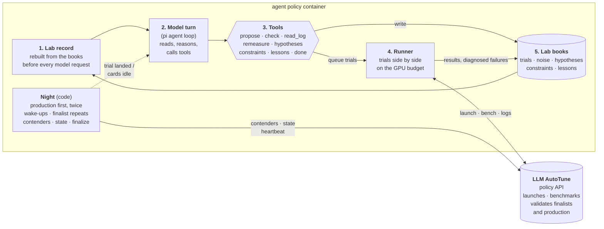

# How the agent policy works

The agent policy lets a language model decide which engine configurations to
try, while ordinary code does everything that must not depend on a model's
judgement: running the experiments, keeping the books, deciding what is a
finalist, and talking to the platform.

## The loop, in plain words

1. **Lab record.** Before every request to the model, the harness writes a
   fresh summary of everything the night knows: every trial with its numbers
   at every load level, every failure with its diagnosed cause, the
   constraints and lessons so far, the open and closed hypotheses, how noisy
   the measurements are, and how much time and how many cards are left. It is
   always the newest message, and it is never shortened.
2. **Model turn.** The model reads the record and decides what to do next.
   [pi](https://github.com/earendil-works/pi) runs this part: the request to
   the model, the tool calls, retries of the call itself.
3. **Tools.** The model can only act through a fixed set of experiment verbs
   — propose configs, dry-run one (`check`), read a trial's details or its
   engine log, measure something again, open or close a hypothesis, write down
   a constraint or a lesson, or say it is done. There is no shell and no file
   access.
4. **Runner.** Proposed configs are queued and started as soon as cards are
   free, several at a time within the night's GPU budget. Each trial is a
   launch, a benchmark, its full results and a release. A launch that fails
   is handed to a short second model call (the diagnostician), which reads the
   log and names the cause and the offending flag.
5. **Lab books.** Results, diagnoses and everything the model wrote down land
   here, and the next record is built from them.

The model is woken when a trial finishes or cards sit idle; between those it
does nothing and costs nothing.

## What code decides, not the model

- **Production comes first, twice.** The production config is measured twice
  at the start, side by side. That pair is the reference every result is
  compared with, and the first estimate of how noisy the measurements are.
- **Finalists.** The best configs are chosen by their mean measurement moved
  one standard error toward worse, with the noise pooled over every repeat.
  One lucky measurement cannot outrank a config measured twice at nearly the
  same level. Near the end, the finalists are measured again.
- **Contenders.** After every trial the current finalists are registered with
  the platform, with their measurements, so whatever happens to the policy,
  the platform validates the latest list.
- **Validation and the verdict.** At the deadline the platform measures the
  finalists, and production next to them, itself. That measurement, not the
  agent's, is the result.
- **Memory across nights.** Lessons, constraints and settled hypotheses are
  saved with the platform at the end and shown to the next night.

## Keeping the model's view honest

- The record is rebuilt from the books every time, so the model cannot drift
  away from what actually happened.
- When the conversation grows long, older turns are dropped (the record never
  is), and old reasoning is dropped first. Before dropping, the model is asked
  once to write down anything it learned that is not yet in the books.
- Every config passes the platform's dry run before it can cost a launch:
  forbidden parameters, the command-line round trip, safety. A refusal goes
  straight back to the model with the reason.
