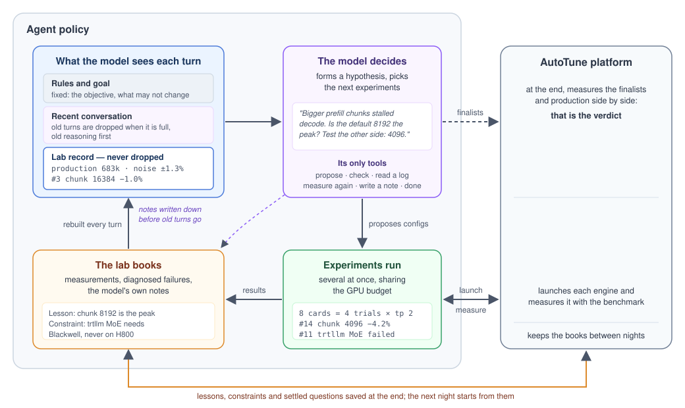

# How the agent policy works

[中文](DESIGN.zh.md)

**The idea.** A language model plays the role of a performance engineer: it
reads what has been measured, forms a hypothesis, and decides the next
experiments. Everything around it is ordinary code: running experiments,
keeping the books, choosing finalists. The platform, not the model, has the
final word.

## The loop

1. **What the model sees.** Three layers, in this order: the rules and the
   goal (fixed), the recent conversation, and the lab record — a fresh summary
   of the night: every result, every failure and its cause, the noise, its own
   notes so far.
2. **The model decides.** It explains what it thinks is going on and proposes
   configs to test it.
3. **Experiments run.** The configs are launched and benchmarked, several at
   once on the night's GPU budget.
4. **The lab books** record the results, and the next summary is built from
   them. The model is woken when a result lands, not on a timer.

## Design choices

- **Memory lives in the books, not in the conversation.** A long
  conversation forgets or drifts; a record rebuilt from the books every turn
  cannot. The conversation is limited by tokens, not rounds: the model's
  context window less room for its reply and the record. Old reasoning is
  dropped every turn; when the conversation passes 85% of that budget the
  oldest turns go, down to 60% — but at 70% the model is first asked to write
  down anything it learned, so what matters survives as a note in the books.
  The record itself is never dropped.
- **The model only gets experiment verbs.** Propose, check, read a log,
  measure again, write a note — no shell, no files. It spends its effort on
  tuning, not on operating a computer.
- **Code decides what is a finalist.** The model cannot write scores. Results
  are compared against production measured twice, and noise is taken into
  account, so one lucky measurement cannot win.
- **The platform runs the experiments and gives the verdict.** The agent
  only asks ("run this config on these cards") and reads back numbers and
  logs. It keeps its current best list registered with the platform; at the
  deadline the platform stops it and measures that list and production
  itself, side by side. A good story from the model does not count.
- **Failures teach.** A failed launch is read and diagnosed, and becomes a
  constraint the model sees on every later turn, so the same mistake is not
  paid for twice.
- **Nights build on each other.** At the end, lessons, constraints and
  settled questions are saved with the platform; the next night starts from
  them instead of from zero.

Built on [pi](https://github.com/earendil-works/pi), which runs the model and
its tool calls; everything above is this package.
