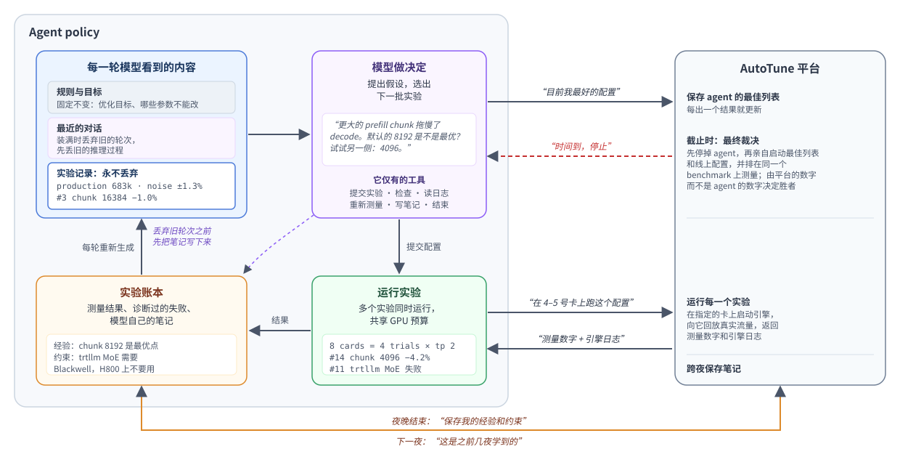

# Agent policy 的工作原理

[English](DESIGN.md)

**思路。** 让一个大语言模型扮演性能工程师：它阅读已有的测量结果，提出假设，决定下一批实验。
模型之外的部分都是普通代码：运行实验、记账、挑选候选（finalist）。最终结论由平台给出，不由模型给出。

## 循环

1. **模型看到什么。** 按顺序分三层：规则和目标（固定不变）、最近的对话、实验记录。
   实验记录是对当晚情况的最新汇总：每个结果、每次失败及其原因、噪声大小、模型到目前为止的笔记。
2. **模型做决定。** 它说明自己对现状的判断，并提交一些配置来验证。
3. **运行实验。** 这些配置被启动并跑 benchmark，在当晚的 GPU 预算内多个同时进行。
4. **实验账本**记录结果，下一轮的汇总就从账本生成。有结果出来时才唤醒模型，而不是按定时器。

## 设计取舍

- **记忆放在账本里，不放在对话里。** 长对话会遗忘或跑偏；每轮从账本重新生成的记录不会。
  对话的上限按 token 算，而不是按轮数：模型的上下文窗口减去留给回复和实验记录的空间。
  旧的推理过程每轮都会丢弃；对话超过这个预算的 85% 时，丢弃最早的轮次直到 60%。
  但在 70% 时会先让模型把学到的东西写下来，这样重要的内容会作为笔记留在账本里。
  实验记录本身永远不会被丢弃。
- **模型只有实验相关的工具。** 提交实验、检查、读日志、重新测量、写笔记，没有 shell，也不能读写文件。
  它的精力花在调优上，而不是操作电脑上。
- **由代码决定谁是候选。** 模型不能写分数。结果会和测量两次的线上配置比较，并考虑噪声，
  所以一次运气好的测量赢不了。
- **平台运行实验并给出裁决。** Agent 只负责提出请求（“在这些卡上跑这个配置”），再读回数字和日志。
  它把当前的最佳列表登记在平台上；到截止时间，平台停掉 agent，亲自把这个列表和线上配置并排测量。
  模型讲得再好也不算数。
- **从失败中学习。** 启动失败会被读取和诊断，变成一条约束，之后每一轮模型都能看到，
  同样的错误不会付出两次代价。
- **一夜接着一夜。** 结束时，经验、约束和已经有定论的问题会保存到平台；
  下一夜从这些内容出发，而不是从零开始。

基于 [pi](https://github.com/earendil-works/pi) 构建，pi 负责调用模型和执行它的工具调用；以上其余部分都在这个包里。
